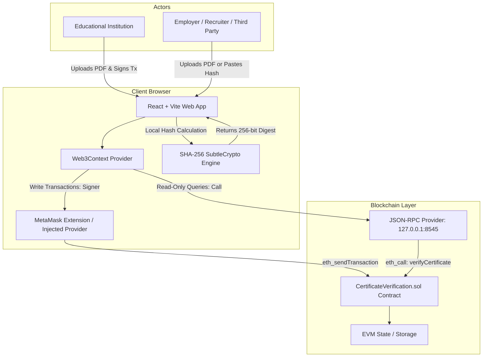
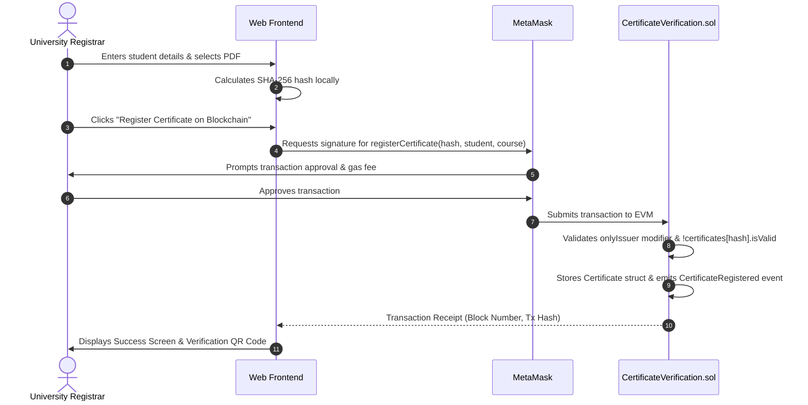
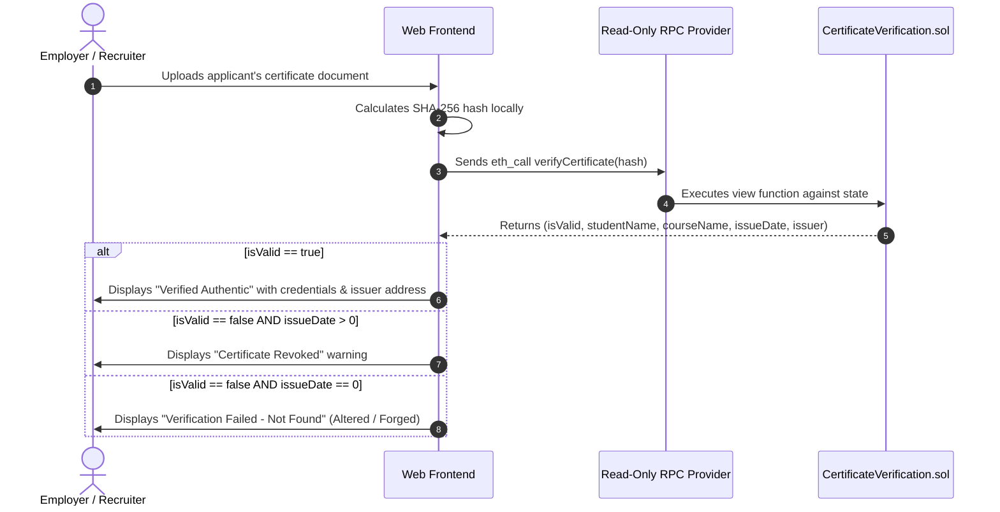

# CertiChain Technical Architecture & System Specification

## 1. Executive Summary

**CertiChain** is a decentralized academic certificate verification platform designed to solve credential fraud, slow verification times, and heavy administrative overhead. By combining **client-side cryptographic SHA-256 fingerprinting** with an **immutable Ethereum smart contract ledger**, CertiChain delivers trustless, instant, and privacy-preserving academic credential verification without storing sensitive student documents on the blockchain or centralized servers.

---

## 2. High-Level Architecture Diagram



---

## 3. Core System Components

### 3.1. Client-Side Cryptographic Engine
- **Algorithm:** SHA-256 (Secure Hash Algorithm 256-bit) via native Web Cryptography API (`crypto.subtle.digest`).
- **Privacy Preservation:** The raw certificate document (PDF, PNG, JPG) is processed entirely in the browser memory using `ArrayBuffer`. At no point is the file transferred over the internet or written to a server or public decentralized storage (IPFS/Arweave).
- **Collision Resistance:** SHA-256 provides $2^{256}$ possible outputs. Even a microscopic alteration (changing a single character or pixel) results in an avalanche effect that renders a completely distinct hash, failing verification instantly.

### 3.2. Smart Contract Layer (`CertificateVerification.sol`)
The smart contract acts as the single source of truth for all issued credentials.

#### Data Structures:
```solidity
struct Certificate {
    string studentName;
    string courseName;
    uint256 issueDate;
    bool isValid;
    address issuer;
}
```

#### Key State Variables:
- `owner`: Contract administrator (deployer). Has administrative authority to authorize and remove institutions.
- `isIssuer`: Mapping of `address => bool` storing verified educational institutions allowed to mint certificates.
- `certificates`: Mapping of `string (SHA-256 Hash) => Certificate`.

#### Functional Matrix:
| Function | Access Modifier | Gas Cost Profile | Description |
|---|---|---|---|
| `registerCertificate` | `onlyIssuer` | State Write (~90k gas) | Registers a certificate hash, student, course, and timestamp. Reverts if already registered. |
| `revokeCertificate` | `onlyIssuer` | State Write (~30k gas) | Marks an existing certificate as invalid. Restrictive: only original issuer or owner can invoke. |
| `verifyCertificate` | `external view` | Free (0 gas `eth_call`) | Queries validity, student, course, issue date, and issuer address. |
| `addIssuer` | `onlyOwner` | State Write (~45k gas) | Adds an authorized university address. |
| `removeIssuer` | `onlyOwner` | State Write (~30k gas) | Removes issuing privileges from an address. |

---

## 4. End-to-End Workflow & Sequence Diagrams

### 4.1. Certificate Issuance Flow (Issuer Portal)



### 4.2. Zero-Trust Verification Flow (Verifier Portal)



---

## 5. Security Architecture & Threat Model

| Threat / Attack Vector | Mitigation Strategy in CertiChain |
|---|---|
| **Document Forgery / Alteration** | Any change to text, grade, or formatting produces a completely different SHA-256 hash, causing immediate `Not Found` verification failure. |
| **Unauthorized Minting** | Protected by the `onlyIssuer` modifier. Calls by non-whitelisted addresses revert with `"Only authorized issuer can call this function"`. |
| **Impersonation of University** | The smart contract records the issuer's Ethereum address on-chain. Verifiers can cross-reference the issuer's address against the university's known public key. |
| **Tampering with Revoked Diplomas** | `revokeCertificate` sets `isValid = false` on-chain. Once revoked, verification explicitly flags the credential as cancelled while preserving the original issuance metadata for auditing. |
| **Replay / Duplicate Registration** | Smart contract checks `require(!certificates[_certHash].isValid, "Certificate already registered")` preventing duplicate entries or overwriting. |
| **Network & Privacy Leaks** | Zero document storage on-chain or off-chain servers; document hashing is 100% client-side. |

---

## 6. Frontend & State Architecture

### 6.1. Dual-Provider Architecture
1. **Signer-Connected Provider (`BrowserProvider`):**
   - Active when an institution connects MetaMask.
   - Handles network switching to Chain ID `31337`.
   - Dispatches state-modifying write transactions (`registerCertificate`, `revokeCertificate`, `addIssuer`).
2. **Read-Only Failover Provider (`JsonRpcProvider`):**
   - Directly connects to `http://127.0.0.1:8545`.
   - Allows verifiers, employers, and candidates to verify credentials **without requiring MetaMask, browser extensions, or cryptocurrency balances**.

### 6.2. Role-Based Access Control (RBAC) in UI
- **Public:** Can access Home (`/`) and Verification (`/verify/:hash`).
- **Authorized Issuer:** Accesses Issuer Portal (`/issuer`) to mint credentials and view issuance receipts.
- **Contract Owner:** Unlocks the administrative tab in the Issuer Portal to whitelist or revoke educational institutions.

---

## 7. Scalability & Production Roadmap

1. **Layer 2 Deployment:** Deploy on low-fee Ethereum L2 rollups (Polygon, Arbitrum, Optimism, or Base) to lower transaction costs to pennies per certificate registration.
2. **Batch Registration:** Implement Merkle tree multi-certificate registration (`registerBatch(bytes32 merkleRoot)`) to allow universities to mint entire graduating classes (thousands of diplomas) in a single transaction.
3. **Decentralized Identifiers (DIDs) & Soulbound Tokens (SBTs):** Integrate ERC-5192 / ERC-721 Soulbound non-transferable NFTs into student crypto wallets as verifiable credentials.
